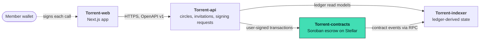

<div align="center">


# Torrent-contracts

**Soroban escrow pools and fully backed payout rights for Torrent savings circles.**

[](https://github.com/Torrent998/Torrent-contracts/actions/workflows/ci.yml)
[](./LICENSE)
[](#status)
[](#status)

Part of **Torrent** — ownership of *when* money becomes available.

</div>

## This repository

`torrent-escrow`, a single Soroban contract that holds the circle's money and enforces every financial rule:

- **Pools and membership**: `create_pool` (bound to the circle's policy hash), `allow_member`, `join_pool`.
- **Escrow**: `deposit`, `withdraw_unreserved` (only what no right reserves), `pause_pool` / `unpause_pool`.
- **Payout rights**: `issue_right` only against unreserved escrow; one owner at a time.
- **Transfers**: `propose_transfer` -> `accept_transfer` (both parties authorize; offers expire) or `cancel_transfer`.
- **Claims**: `claim` by the current owner, after maturity, exactly once.

The backing invariant `reserved <= funded - claimed - withdrawn` is asserted after every mutating call and checked
by property tests over random sequences of deposits, issues, transfers, claims, withdrawals and pauses. Fee-on-transfer
tokens are rejected. Every mutating call uses Soroban authorization and its unauthorized paths are tested.

Public boundary, versioned (ABI v1): [`bindings/abi.v1.json`](./bindings/abi.v1.json) (functions, auth, errors),
[`bindings/events.v1.json`](./bindings/events.v1.json) (event topics and data, consumed by Torrent-indexer),
[`bindings/scenario.v1.json`](./bindings/scenario.v1.json) and [`bindings/stream.v1.json`](./bindings/stream.v1.json)
(the real events emitted by that scenario, as base64 XDR).

## Quickstart

Requires Rust stable (1.85+).

```bash
git clone https://github.com/Torrent998/Torrent-contracts && cd Torrent-contracts
rustup target add wasm32v1-none
./scripts/check.sh            # fmt, clippy -D warnings, all tests, wasm compile smoke check
./scripts/check-bindings.sh   # regenerates bindings/ from the real contract and fails on any drift
```

Nothing to shut down (no services). Deployment steps for stellar-cli are in
[deployments/README.md](./deployments/README.md).

## Status

| Area | State |
|---|---|
| `torrent-escrow` (pools, membership, deposit, issue, transfer, claim, withdraw-unreserved, pause) | implemented |
| Tests: unit and failure paths, per-signer authorization, fee-on-transfer rejection, event golden, ABI surface, property tests (backing invariant, ownership model) | 36 passing in the Soroban test host with a Stellar Asset Contract token |
| Bindings drift check (`scripts/check-bindings.sh`) | in CI |
| Deployment scripts (`build.sh`, `deploy-testnet.sh`, `smoke-testnet.sh`) | written, **never run** |
| Wasm compile smoke check (`wasm32v1-none`) | passes; not a deployable build (needs `stellar contract build`, stellar-cli >= 25.2) |
| Testnet deployment / transaction hashes | **none yet** |
| Security audit / Mainnet / real funds | **no** / **no** / **no** |

Design record: [docs/adr/0001-escrow-contract-design.md](./docs/adr/0001-escrow-contract-design.md).

## What is Torrent?

In a savings circle, members contribute to a shared pot and take turns receiving it. Sometimes a member
needs their payout earlier, or would happily take it later. **Torrent lets members exchange the timing of a
payout, but only for payouts that are already fully funded.**

1. **Create a circle.** An organizer sets the rules; their hash binds the circle to an on-chain pool.
2. **Fund the pool.** Members deposit a supported Stellar asset into a Soroban escrow contract.
3. **Issue payout rights.** Each right has a unique id, owner, amount and maturity. The contract refuses to
   issue a right that is not covered by unreserved escrow.
4. **Transfer or claim.** The owner proposes, the recipient accepts, both sign. At maturity the current owner
   claims exactly once.

The contract enforces one invariant after every call: `reserved <= funded - claimed - withdrawn`.
A payout right never represents a future contribution that has not been paid.

## Architecture

Torrent is four independently tested repositories, each owning one boundary. The contract is the only source of truth for backing, ownership and payout; the indexer reconstructs that truth from the ledger; the API organizes people and signing requests; the web app shows it honestly.



| Repository | Stack | Owns |
|---|---|---|
| **[Torrent-contracts](https://github.com/Torrent998/Torrent-contracts)** (this repo) | Rust · Soroban SDK 29 | Escrow pools, fully backed payout rights, member-only transfers and one-time claims. The only writer of financial truth. |
| [Torrent-indexer](https://github.com/Torrent998/Torrent-indexer) | TypeScript · Node 22 · Stellar RPC | Ingests contract events with a durable cursor and rebuilds pools, rights and transfers from the ledger. |
| [Torrent-api](https://github.com/Torrent998/Torrent-api) | TypeScript · NestJS · SQLite | Circles, invitations, wallet sign-in and the signing-request state machine. Holds no keys and no balances. |
| [Torrent-web](https://github.com/Torrent998/Torrent-web) | TypeScript · Next.js 16 · Tailwind CSS 4 | Landing page and web app: circles, coverage, rights, transfers, claims and signing requests. |

## Project documents

| Document | What it covers |
|---|---|
| [docs/PRD.md](./docs/PRD.md) | Product purpose, users, MVP and non-goals |
| [docs/SRD.md](./docs/SRD.md) | Domain model, state machine, API surface |
| [docs/ARCHITECTURE.md](./docs/ARCHITECTURE.md) | The four repositories and how data flows between them |
| [docs/STELLAR_PROTOCOL.md](./docs/STELLAR_PROTOCOL.md) | Contract specification and invariants |
| [docs/SECURITY.md](./docs/SECURITY.md) | Threat model and go-live restrictions |
| [docs/ROADMAP.md](./docs/ROADMAP.md) | Milestones and quality gates |
| [docs/BRAND.md](./docs/BRAND.md) | Approved logo and interface principles |
| [docs/adr/](./docs/adr/) | Architecture decision records for this repository |
| [AGENTS.md](./AGENTS.md) | Rules for AI coding agents working in this repository |

The shared product documents are mirrored in all four repositories; the canonical copy lives in
[Torrent-api](https://github.com/Torrent998/Torrent-api/tree/main/docs).

## Contributing and Drips Wave

Contributions are welcome. Start with [CONTRIBUTING.md](./CONTRIBUTING.md), then pick a scoped task from
[docs/CONTRIBUTOR_ISSUES.md](./docs/CONTRIBUTOR_ISSUES.md). Each task names its motivation, the files it touches,
acceptance tests and non-goals. Changes that cross a repository boundary go through the versioned fixtures
each repo publishes, so every PR stays reviewable on its own.

Torrent intends to apply to the [Drips Wave](https://docs.drips.network/wave/maintainers/participating-in-a-wave/)
program for Stellar projects. Participation is subject to Drips' review; nothing here implies approval or rewards.
Please follow the [Code of Conduct](./CODE_OF_CONDUCT.md).

## Security

Torrent is an **unaudited prototype for Stellar Testnet**. Do not use it with real funds.
Please report vulnerabilities privately as described in [SECURITY.md](./SECURITY.md); do not open public issues
for them. The threat model is in [docs/SECURITY.md](./docs/SECURITY.md).

## License

[MIT](./LICENSE). The Torrent logo in [`brand/`](./brand/) is the project's approved identity and is shared by all four
repositories; see [brand/README.md](./brand/README.md) for usage rules.
